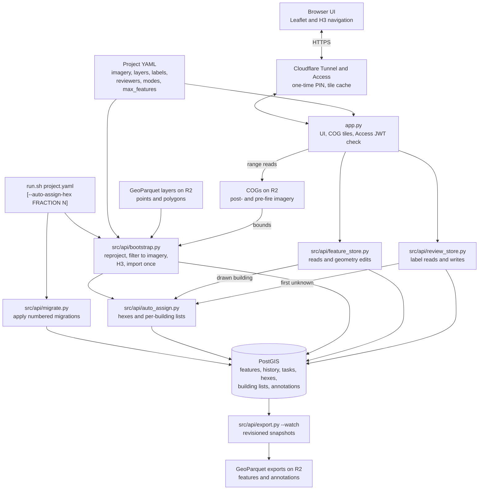
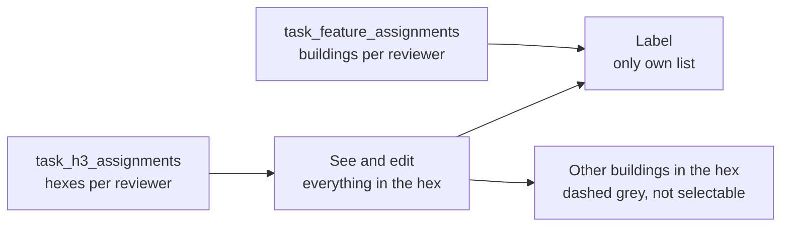
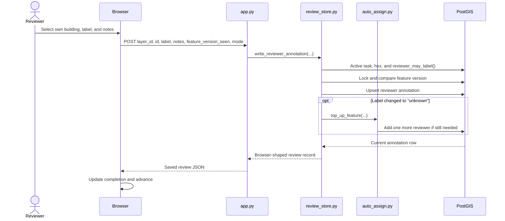
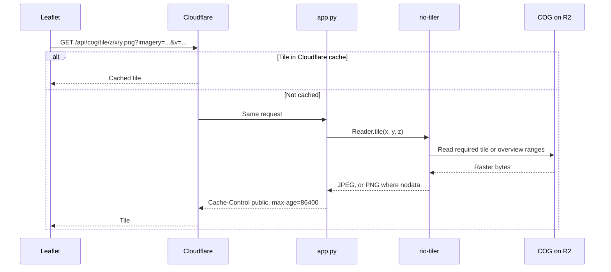

# Application Flow

The application is YAML-configured and PostGIS-backed. Independent point and
polygon GeoParquet layers initialize the database; reviewer clients never edit
object-storage files directly.

## Runtime Flow

`run.sh` runs the left-hand side once per deploy; the rest keeps running.
Without `--auto-assign-hex`, bootstrap reuses the saved assignments.

## Browser Requests

| Request | Purpose |
|---|---|
| `GET /api/config` | Reviewer, layers, modes and hexes (read fresh each page load) |
| `GET /api/buildings` | Features in the reviewer's hexes (or a whole layer, like DINS); each says if it is `annotatable` |
| `GET /api/annotations?mode=annotation` | The reviewer's own labels |
| `POST /api/annotations?mode=annotation` | Save a label |
| `POST /api/features` | Draw a building |
| `PATCH /api/features` | Move or reshape a feature |
| `DELETE /api/features` | Delete a polygon |
| `GET /api/cog/info`, `GET /api/cog/tile/z/x/y.png` | Imagery |

## Who Sees and Who Labels

With `--auto-assign-hex FRACTION N`, every building gets N counted labels;
the first "unknown" on a building does not count. Labelled and drawn
buildings stay on their reviewer's list, the rest is shared out hex by hex,
and `max_features` caps a list. `reviewer_may_label()` in migration 006 is
the one rule the label checks use. Tasks without lists (`feature_lists =
false`) label everything in the hex, as before.

## Annotation Save Sequence

Annotation tasks are layer-specific. The database unique key also includes
reviewer identity, allowing multiple reviewers to annotate the same feature
without overwriting each other. Drawing a building works the same way:
`feature_store.py` inserts it, then `top_up_feature` puts it on the
drawer's list and on N - 1 other lists.

## COG Tile Sequence

The `v=` parameter carries the COG source, so new imagery gets new cache keys.
